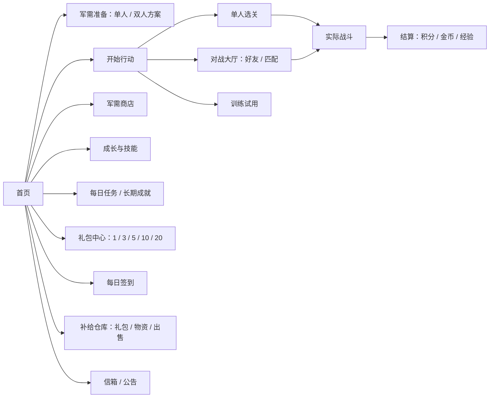

# 夜航守望 · 成长、军需与奖励体系方案

更新：2026-11-01。设计基线：`5ab3da84077c8cab2d2012d312f55c470d0a21e5`。本文件为该主题的当前正文，替代此前“仅从上线后累计、不补历史”的计划。

**状态：产品规则已按本次讨论汇总；仅方案与概念图，未实施运行代码。** 新效果图供本次视觉评审，尚不等于用户已认可全部画面、运行截图或功能验收。数值均需按后文区分“确定规则”和“示例参数”。

相关资料：[分批实施计划](personal-assets-implementation-plan.md) · [关键效果图与提示词](progression-2026-10-31/README.md) · [当前界面规范](interface.md) · [游戏 README](../../README.md)。

## 1. 已确认的产品边界

- 原积分、战绩与积分排序规则保留；新增金币、经验及等级。金币是游戏内资源，没有人民币充值、钻石、付费货币。
- “提高活跃”是运营目标，不设置活跃度数值、活跃币、活跃条或累计活跃宝箱。
- 单人和双人均允许个人成长、军需带来的优势；不归一化双方属性，不新增联合或共享技能。本人使用的能力属于本人；攻击或控制作用于合法敌方目标。
- 成长基础被动达到等级自动生效；永久技能指永久拥有装备资格，发动效果仍是短时状态。
- 技能在一场内按冷却反复使用，没有总次数、施放券或单次发动扣库存。临时技能商品提供一场使用资格。
- 普通消耗品默认持续一场；单人一关是一场，双人一个正式对局是一场。真正单次触发的例外必须单独标明，首版不新增这种技能。
- 电磁干扰属于主动技能；无人机机群、激光属于武器。激光弹药/发射次数限制不等于技能次数限制。
- 军需准备与开始行动是独立流程；单人、双人方案分别保存，以后开局自动应用，不自动花金币补货。
- 每类装备有数量上限，同效果不得重复装备；两连发与双弹道是不同效果，允许组合，通过金币价格、稀有度及槽位控制供给。
- 旧单人局内广告追踪继续保留；不新增双人局内广告支援。
- 最新首页修订：**上方“军需准备”，下方“开始行动”**；开始行动仍为黄铜主按钮。右侧原“广告礼包”改名为**“礼包”**。
- 礼包支持金币购买或观看视频兑换，套餐数量固定为 **1、3、5、10、20 个**，批量购买有优惠；具体价格、视频数和折扣是待验证参数。

## 2. 资源与体系职责

| 资源/体系 | 来源与用途 | 不能混用的边界 |
| --- | --- | --- |
| 积分 | 沿用当前合法单人/对战结算及排行榜规则 | 不扣作购买费用、不转换为金币 |
| 金币 | 有效对局、任务、签到、礼包、物资回收、补偿；购买军需与礼包 | 服务端记账，待同步收益不能提前消费 |
| 经验/等级 | 有效对局和明确任务奖励；等级自动解锁被动及资格 | 经验不消费；等级由版本化经验曲线计算 |
| 商店 | 确定购买单场、24小时、永久权益；训练试用 | 不自动购买，不重复购买已拥有的同档永久资格 |
| 礼包 | 有稀有度的随机一次性物资，金币直接到账 | 不掉落永久技能或永久增益，不新增碎片货币 |
| 每日任务 | 每日随机3～5项，直接发金币、经验或礼包 | 不发无限叠加的永久属性，不设置活跃奖励条 |
| 长期成就 | 有限里程碑，永久权益或若干礼包 | 每档一次，重复解锁不继续叠数值 |

### 结算口径

单人、真人双人、服务器人机的有效完成均计算基础金币和经验，胜利/首通可有加成；失败和对战平局必须有明确收益规则，不能仅在“成功通关”函数内接入。主动退出、挂机、短时反复开局不按正常有效完成发奖。

热身、本地机器人和训练试用不扣正式库存、不产出可消费服务器资产、不推进正式经济任务。联网失败可保留原有本地玩法和可验证输入日志；服务端确认前仅显示“待同步”，不能把本地预测余额覆盖云端余额。

结算分别显示原积分、金币、经验、用时、评价与纪录，并显示“服务器已到账/待同步/需重试”。同一场结算只能发奖一次。现有积分公式不因加入金币改变。

### 排行兼容

个人养成进入双人后仍使用原积分规则，允许成长差异。可优先匹配接近的战绩与成长区间，等待后放宽，不新增多套稀释人数的匹配池。

单人最快时间记录需带战斗规则版本及军需快照；旧纪录保留为历史规则记录，成长版同条件比较，不直接跨版本混排。不能把自动成长玩家永久判为“广告辅助”。旧广告辅助成绩继续遵循原资格规则。金币、经验不成为原积分榜的新排序字段。

## 3. 商品、资格与配装

### 期限和消耗

| 类型 | 拥有与生效规则 | 扣除/到期规则 |
| --- | --- | --- |
| 单场武器/改装/技能资格 | 装备后提供这一场的武器、增益或技能访问权 | 正式开战消耗1件；技能当场可按冷却反复用 |
| 24小时增益 | 购买入库，主动激活后连续24小时；在对应槽位装备才生效 | 同效果续期不叠强度；开局有效则该局保留，下一局重新核验 |
| 永久权益 | 以后持续拥有；基础成长自动生效，特殊改装/技能按方案选用 | 不消耗库存；已永久拥有同效果时不再扣临时资格 |

“拥有多个”允许库存累加；“装备多个”和“效果重复叠加”分别受限制。相同效果换名称、来源、期限不能绕过上限。永久商品不得因免费解锁后重复收费；旧临时物品仍能回收。24小时是连续现实时间，不能暗示24小时在线战斗时间。

### 首版槽位方案（实施起点，数值验证后可调整）

- **武器改装：2个。** 威力、射速、连击、弹道、范围、武器冷却等特殊改装占此类槽；限制针对整套方案，不是每把武器各有2个。
- **特种武器：1个。** 无人机或激光择一；原有基础武器不因此移除。
- **主动技能：1个。** 追踪或电磁干扰择一。
- 等级基础被动不占以上槽位；互斥关系按效果组定义。限时/永久商店改装仍按其类型占槽。
- 每个效果明确适用武器白名单；同类型百分比按统一顺序合并，不按奖励来源分别乘算。两连发与双弹道可以共同装备。
- 配装预览展示投射弹数、实际耗弹、主副弹强度、每轮热量与完整攻击间隔。每轮只消耗1发弹药和一份热量：无改装主弹100%；单改装主弹100%＋副弹60%；“两连发×双弹道”主弹100%＋3枚60%副弹（名义总强度280%，不是四倍伤害）。连发移除额外0.1秒整轮冷却，轮内延迟为min(0.1秒,有效冷却/2)。
- 2026-11-01 散布与消耗调整：主弹沿原炮口飞向准星；两连发副弹沿射向前后交替，双弹道副弹左右交替，组合为主弹＋周围三点覆盖。单副弹偏移为clamp(基础爆炸半径×55%,0.35,2.4)，三副弹半径再乘√2；方向随实际耗弹次数确定性轮换，不使用随机数。全部落点共同参与地图边界、保护区与友军风险检查。追踪锁定保持精准，主副弹强度预算仍生效。
- 燃烧副弹保留火区半径，通过缩短持续时间限制覆盖预算：主弹25秒、每枚60%副弹15秒，重叠火区持续伤害不叠加。耗弹独立计数；旧记录缺字段时按旧投射弹数恢复，训练最佳与有效参与门槛使用实际耗弹，命中弹/投射弹仍独立展示。
- 武器冷却缩减不自动缩减技能冷却。技能缩减如以后加入，单独定义最低间隔。

### 持久方案与开战事务

保存只改变未来方案，不扣物品、不强制跳转开始游戏。首次选择单场物品说明“以后每场自动消耗1件”，可关闭该项自动携带。

正式开局前由服务端核验资格、库存和有效期，预留物品并固定本场效果与规则版本；未开局取消释放预留。正式开始提交本场消耗。库存不足/过期跳过对应物品并明确提示，不自动购买；基础武器及正常开始始终可用。

同一对局刷新、重连、重新进入不重复扣除；“再次出动”产生新对局。战斗中修改方案仅影响下一场。已预留物品不能同时出售或供另一设备再消费。服务器认定无效对局按统一规则返还，正常主动退出不退已消耗资格。

## 4. 技能与新增武器

| 能力 | 归类 | 首版效果与边界 |
| --- | --- | --- |
| 追踪 | 主动技能 | 短时间为明确白名单内的普通武器提供追踪，示例60秒；不改变原弹药、地形碰撞和友伤规则；激光和自带寻敌的无人机不重复获益 |
| 电磁干扰 | 主动技能 | 由本人发动，使敌方地面单位短时停止移动；当前炮台本就不移动，首版不顺带禁止其攻击；已发射弹丸继续运行；结束后短暂抗控避免无缝连续定身 |
| 无人机机群 | 特种武器 | 自动寻找最近合法敌方单位，造成伤害与减速；限定寿命、总伤害和数量；目标死亡可换目标，不重置预算；减速取最高值而非无限相加 |
| 激光 | 特种武器 | 合法目标在射程、视线内时发射即命中，无需提前量；仍受地形和保护区约束；长冷却、有限弹药，不默认一发秒杀重甲 |

技能永久资格可由等级/长期成就获得，单场资格由商店或允许的礼包获得。技能从效果结束后开始冷却，冷却完可再次发动，无本场次数限制。单人暂停冻结战斗时间；双人由服务器继续推进。切枪、刷新、重连不恢复冷却。

旧单人广告追踪保留原独立入口与资格，不回充新技能冷却、不重复叠加强度；效果已生效时避免重复领取浪费。保留重复广告来源意味着单场追踪资格的价值是免观看便利，不宣称所有来源合计有严格每场次数上限。

现有全局buff字段需要拆为玩家所有的效果、冷却与状态；不能让甲使用后乙也受益。技能和武器都通过相同纯规则进入客户端表现、服务端模拟和回放，不放开客户端任意“发放增益”指令。

## 5. 礼包、套餐、签到与回收

### 入口与套餐（2026-11-01修订）

首页右侧“礼包”进入礼包中心；每日签到保留独立快捷入口。礼包中心提供“金币购买/视频兑换”，统一列出1、3、5、10、20个套餐。购买只发未开启礼包，玩家可打开单个或批量打开，也可从仓库回收。

套餐展示数量、总价、单包均价、相对单买节省数额。视频方式展示所需完整观看数、当前完成进度和可继续入口；不要用模糊“免费观看”掩盖需要多段视频。未满足视频库存或每日额度时说明原因，金币途径和普通游戏继续可用。

**以下仅为效果图示例，不是正式定价：** 单包200金币，3个570、5个900、10个1,700、20个3,200；相应折扣0%、5%、10%、15%、20%。视频数量单独配置，图示5个套餐需3段完整视频，不能从金币折扣直接计算。正式参数需核算观看负担和金币获取速度。

多段视频绑定一个服务端兑换订单，已确认观看进度跨刷新/重连/日切保留，继续时仍用原订单与报价。未完成不发整套礼包，完成后仅发一次。每日视频额度按服务器日期计算；到额度可次日继续，不清除已完成进度。不新增可交易“视频币”，不允许换套餐重复使用同一观看凭据。切账号隔离订单。正常关闭页面不丢已确认进度。

### 稀有度与来源

礼包有普通、精良、稀有、史诗四档。来源按版本化权重发放对应档礼包，包内只发本档一次性内容；避免再套第二套随机星级。领取/购买前可查看礼包档位概率和内容池，开包结果保留可查询回执。示例档位颜色不代替文字。

礼包分明确来源池：通用补给支持金币与视频两种方式；金币军需池可包含金币限定强力改装。两连发/双弹道等金币限定物品不进入签到、视频、免费任务或补偿礼包池。来源池区别在购买前说明，不能同名同图却暗中换概率。金币限定道具同时提供高价确定购买路径，避免只能碰运气。

批量优惠只改变成本，不暗中提高或降低单包概率；同款同来源单买与套餐使用同一已展示奖池。是否增加保底留待数值验证，首版不承诺未实现的保底。

### 签到、物品与回收

签到采用累计天数，漏签不清零历史累计。每日日期统一由服务器北京时间决定。金币奖励直接到账；武器、改装、技能资格入库，默认一场使用；礼包不发永久技能。

可回收未开启礼包和可出售物资，出售前显示数量与总金币；预留中物品不能出售。最优惠套餐成本、开包产物回收、任务奖励链一起核算，避免“买包→卖产物→买更多”或“开包任务→礼包→重复奖励”的无限循环。

高稀有度有明确最低价值，永久资格已拥有导致临时券不再需要时仍能出售。稀有度不只计算单次概率，还核算玩家每日可获得的总份数。

## 6. 每日任务与长期成就

服务器从任务库按账号和日期选定3～5项并保存，重启、刷新和换设备不能重抽。可使用签到、完成若干关卡/双人/好友对战、获得胜利、打开礼包、完成有效视频兑换等模板；名称必须区分关卡任务与日常目标。

任务按玩家等级、已解锁玩法、渠道能力筛选，避免重复、互相冲突或不可能条件。好友/视频任务提供等价值替代；不把购买指定商品或消耗稀有道具作为日常基础奖励的必经条件。不能靠反复更换任务刷奖励。

每项直接显示进度和金币/经验/礼包，支持一键领取；不设活跃条。任务数量变化时控制总体完成负担与奖励预算。长期成就使用有限里程碑，永久权益每档只解锁一次，基础被动自动生效。

任务窗口采用服务器北京时间00:00跨日；对局计数归入服务端认可的结束日，不能靠延迟上传重复跨日计算。昨日已完成未领取奖励保留7天作为首版建议，单独列入历史可领取项，不影响新任务。视频任务按已确认的唯一观看完成事件计数，礼包兑换另按发货事件计数，不因重复回调推进。

## 7. 公告、信箱与老玩家补偿

公告面向全体，提供生效时间和版本内容；个人信箱承载补偿、个人通知和附件。未读、已读、附件待领取、已领取分别保存，打开信件不会自动领附件。补偿邮件长期保留，未领取附件的邮件不能普通删除；领取后保留记录。

资产绑定不可变`(gameId, playerId)`，不能按昵称或短ID合并。首次验证游客绑定可沿用现有身份迁移；Tap账号已有玩家时不自动混入另一游客资产。换账号后旧回执、库存和邮件不能污染新账号。

补偿采用基础回归礼包 + 可信历史成绩对应的有上限金币/经验。原积分、关卡进度、既有广告资格不扣除、不兑换。仅本地历史没有权威证明时使用明确有上限的回归方案，不相信客户端任意历史局数。补偿依据截止时间、版本、玩家唯一生成；附件领取与资产入账原子完成，不重复领。

先核对线上实际部署和数据库：代码回退不代表旧钱包、购买或消耗数据已经回退。有旧经济记录时先形成保留/补差方案与只读预演，再发对应邮件，不能直接清零重建。

## 8. 首页与页面组织

首页左侧军需准备在上、开始行动在下；开始行动仍是视觉主操作。右侧每日签到与礼包并列为简洁福利入口。底部军需商店、成长技能、任务、补给仓库。顶部显示玩家等级/经验、金币、信箱/公告和既有设置/战绩入口。

模式页只显示当前方案摘要，允许查看，不强制再次配置。红点仅用于可领奖或重要未读，不因商店有商品长期亮起。设置、帮助及既有返回路径保留；军需页返回基地不自动进入对战。

## 9. 服务端与一致性边界

复用现有身份、单人输入重放、双人结算事件和公共广告端口，不新造通用经济平台或事件总线。商品、资格、效果、库存、配装、订单、奖励记录分别描述。

必要数据：钱包/累计经验/版本；不可变奖励流水；商品及奖池版本；购买/视频兑换订单；数量或期限库存；永久资格；单人/双人方案；对局配置快照与预留；每日任务及事件去重；成就领取；公告/个人邮件；补偿批次。

所有购买、开包、出售、领取和正式消耗均由服务端核验。请求编号固定，超时按原编号查询/重试；同编号不同参数拒绝。行锁/条件更新防止跨设备透支。扣币与发货、领取与入账保持事务一致；客户端只保存意图及权威快照。

当前广告完成回调不等于服务端可信观看证明；新增可出售礼包之前必须核实目标H5渠道可验证凭据。没有凭据时明确风险、限额、订单与异常监测，不能把随机challenge当观看证明或在文档中宣称已解决。旧单人本地支援与新云端兑换风险分别记录。

## 10. 交付、效果图与待验证数值

关键概念图覆盖首页、模式选择、军需、商店、礼包套餐、成长技能、任务、信箱及结算；均为内置imagegen生成，不是截图。最终采用的图、提示词、尺寸及哈希在[图册](progression-2026-10-31/README.md)登记。未修改运行时素材或已发布截图。

确定的交互与规则优先于图中示例数字。槽位起点2/1/1、等级门槛、冷却/控制时长、商品价格、套餐折扣、视频段数、掉落权重、收益和补偿金额仍需模拟及实际对局验证。当前图不授权直接攻击对方飞机，也不新增充值入口。

实施前还需补齐战斗HUD技能“可用/生效中/冷却”、24小时激活和续期、库存不足、概率详情、视频多段进度/失败、金币不足、邮件已领及待同步结算等关键状态效果图；这批九张图是主要页面方向，不冒充所有状态已经完成设计。后续各批补图和代码均须遵循[通用视觉验收](../../../../../docs/game-development.md#新样式要求与完整视觉验收)，在568×320、844×390、1280×720及竖持兜底检查。

本轮不执行构建、运行测试、数据库迁移、服务部署、Git推送或平台上传；设计资料按用户后续明确授权提交。方案批准不自动等于运行代码实施授权。
