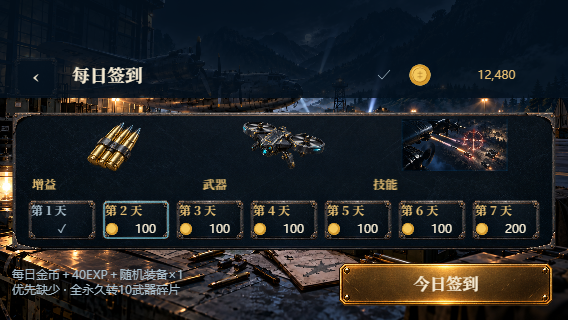
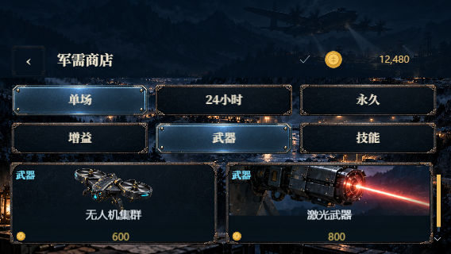

# 2026-11-07 增量优化

## 同日后续：补给箱、纯视觉转盘与中等规模战场

当前 Creator 源码摘要为 `9867cdc426ae9dc2ca33d28f8de04afdaef7739fdb61ab784e5b67b4d9a453c2`。以下为当前修订；分隔线下保留此前驻守版的历史采集身份。

本次转盘动效修复：系统或游戏“减少动效”不再直接揭晓；普通模式保持5圈以上、缓和模式1圈以上，均经过4.8秒加速、匀速与渐停后显示结果，显式“跳过动画”仍可提前揭晓。待机光环持续呼吸，缓和模式降低亮度变化；点击反馈保持圆形，外圈或轮盘矩形范围内的圆外区域轻晃0.4秒，不扣次数。12分区金属外圈和彩色扇面保留。

本次验证：136项军需/HUD/输入测试、类型检查及Creator web-mobile构建通过（59,559,735字节）。568×320、844×390触屏、1280×720鼠标及568×320减少动效共4场真实浏览器检查通过；逐帧角度递增、自然揭晓至少4.8秒、外圈轻晃回正且次数不变、跨周期光环、跳过精确落点、无次数提示均通过，无页面异常。[动效回执](army-wheel/motion.json)、[外圈反馈](army-wheel/nudge-568-no-preference.png)、[缓和模式旋转](army-wheel/spinning-1-568-reduce.png)。概率奖励使用隔离夹具，不代表真实到账；另以普通新游客实连Sakura核验当前版本和奖池，本地与公网Runtime健康200。仅更新本地前端，继续使用既有Runtime/PG；旧宣传视频保留采集身份，八类37项资料文件摘要核对通过。未验证实体手机、真实广告、原生宿主或生产部署。

玩家文案统一为“补给箱”，四档为普通、精良、稀有、史诗补给箱，入口为“补给”。原库存ID和历史回执不迁移。签到、精良及以上补给箱、转盘随机装备期限为单场90%/24小时10%；24小时先入仓库，手动激活后计时。签到优先缺少效果，补给箱按原档位与等级筛选，永久权益不重复发放。旧服务缺少期限配置时，据实显示仅单场。

| 转盘概率 | 组合奖励 |
| --- | --- |
| 28% | 120金币＋40 EXP |
| 22% | 普通补给箱×2＋武器碎片×2 |
| 20% | 随机增益＋40金币 |
| 14% | 随机武器＋60金币 |
| 12% | 随机技能＋60金币 |
| 4% | 史诗补给箱＋随机24小时装备 |

按本次最终反馈，盘面升级为12个分区，保留金属外圈和质感，采用蓝/紫/青/橙交替的完整彩色扇面、细金色分隔线、星形装饰与旋转中心图形；没有奖品和概率文字，提示按钮列出完整内容。空闲灯光呼吸，点击有光圈和短音；有次数直接请求扣一次，无次数提示“看视频获得1次抽奖次数”，另点视频按钮才播放。转动共4.8秒：0.6秒加速、1.6秒匀速、2.6秒渐停，原创五声音阶音效配合转速。重复点击和丢失响应沿用交易幂等；跳过立即落点，失焦或静音停音，恢复按进度续播；减少动效设置保留。

战场采用8片步兵阵地，前三关24/36/48名，后续48–96名；同时最多24装甲，总活跃敌人上限120。双人每方48步兵＋8装甲。低矮沙袋阵地避让部队和道路，不改变弹道。回放v16、对战v9、最快榜v4，历史榜和首通权益保留。触屏开火默认直径68→136，小屏操作自动分行；“无人机 3”同行，电磁干扰就绪蓝、生效绿、冷却金，其他倒计时独立着色。

验证：120关基础武器无补给、无友伤通关；延迟且四分之一故意射偏的中等规模战斗在10分钟内完成且友军无损失。旧时限余量断言改为无硬时限下的通关时长边界。客户端奖励、输入、HUD、排行历史版、Runtime规则定向检查及两端类型通过。真实隔离PostgreSQL29项全部通过，强制覆盖三类装备×两种期限×三个奖励入口、并发幂等、组合发放和无次数拒绝。Native源码适配守卫更新已审阅摘要并通过HUD消费者；未运行原生渠道构建。

三尺寸转盘、7组操作布局通过：跳过落点、无次数反馈、名称数量同行、状态颜色、独立拖动与重开恢复。[转盘QA图](army-wheel/wheel-568.png)、[就绪](army-wheel/controls-ready-568.png)、[生效](army-wheel/controls-active-568.png)、[布局回执](army-wheel/controls.json)。这些夹具不代表真实账户到账。

真实Sakura桌面/触屏单人及双人开火均击杀步兵，双人112单位、双方死亡状态一致；FPS P10为59.54–60，准星P90误差低于0.009世界单位。[真实联调](army-wheel/live.json)。第120关192目标合法输入回放，保留176残骸＋16存活敌人时，1280×720/568×320 FPS P10为59.80/59.96，247 draw calls。[渲染压力](army-wheel/late-wave.json)。这是桌面GPU证据，不是实体手机性能承诺。

本地Runtime `night-20261107-army-wheel` 已替换，435项制品摘要、7份Night核心和86份Runtime产物与当前工作区一致。35表备份恢复比对成功，原PostgreSQL保留，未在原库迁移；本地/Sakura健康、匿名401、其他游戏/内部入口404及CORS通过。[部署回执](army-wheel/deployment.json)。前端 http://localhost:4318 使用现有Sakura API。

新版普通游客约90秒连续首关录屏采用1920×1080原始画布与真实游戏音轨，正常输入清除28目标并获服务器结算；新增战斗/选关/结算三张正式图，另补12分区转盘真实游客截图。八类37项媒体核验保留历史文件采集身份。[录制证据](army-wheel/media-source.json)。录屏及战斗/布局证据保留采集摘要 `cb7a8ebea0e5a54314545c67db0ab5469ffd53a52b418391a03f4bf71f9d3fd0`；之后只改转盘呈现与落点，未改战斗或服务器奖励。12分区版重建后另跑81项HUD/转盘单测与三尺寸专项。原版宣传片、图标和封面继续保留，QA图不混作正式素材。

实体手机、TapTap宿主及真实广告、长期玩家经济、原生包与生产部署未验证或执行；没有上传渠道包。普通dev推送保留hooks，未运行本地全仓候选测试，CI状态独立记录。

---

concept.png 仅为分类、完整插画、金属材质及长期成就的信息层级参考，由 OpenAI imagegen 生成。图中直升机、导弹、分类混排、价格和奖励数值不作为实现依据；沿用现有装备与用户确认规则。

商店保留期限选择，新增增益/武器/技能分类与卡片标签。签到优先缺少的效果，再类别等概率、类别内等概率；永久、有效时限、任一期限库存均算已有。所有效果永久时转换10武器碎片。金币/EXP保留，先升级再选择。

礼包档位概率60/25/12/3不变：普通40金币+10EXP+1片，精良60+20+2片+装备，稀有100+40+3片+装备，史诗200+80+5片+装备。无候选装备金币总额沿用40/120/300/800。技能可提前送单场，等级永久资格生效后不再送对应资格；每箱先加EXP再更新资格。最坏回收期望130.1金币，低于最低购买单价160金币。

长期成就新增行动250/500/1000、胜利100/250/500、签到7/30/90。以原权威战斗回执及签到历史一次回填，旧三项及已领取状态保留。

驻守步兵HP16、伤害2、射程14、速度0，射击间隔为现有关卡间隔的3倍；单人12/18/24，后续24–48；同时存活非步兵最多24、步兵最多48、总72。双方对战各24步兵，保留各8装甲单位。机枪弹速180、伤害8和爆炸范围0.5不变；连续身体碰撞按人形高度匹配并先比较地形。回放v15/对战v8/榜单v3，保留canonical首通，个人最快时间新key隔离旧物理。

最终 Creator 3.8.8 web-mobile 源码摘要为 `1828248a67d0178cd37bd6306eb7486e410289e336cf13b48ae635f9233349d3`，59,293,858 字节。步兵部署点由规则与场景共用，树木、房屋、岩石及草簇避让步兵位置；未移动既有权威坐标。双人飞行引起的准星投影变化通过现有输入队列同步到服务器，连续瞄准指令仍合并发送。

234项玩法/成长/输入规则（含120关无补给、无友伤通关）、32项在线、3项Runtime核心、53项真实PostgreSQL专项通过；后续部署坐标复用的12项步兵/对战规则、预测自检与Night/Runtime类型检查通过。HUD57项、火区/原生适配16项通过。PostgreSQL覆盖批量组合奖励、跨等级自动资格、幂等重试、成就历史回填及无效/过短行动排除。

实际Creator画布在568×320、844×390、1280×720中英文及52px顶部安全区/胶囊共8个场景通过，包含9种期限/分类组合、大厅顶部入口、完整签到图片、长期成就和组合奖励滚动。浏览器异常0。[逐项回执](qa/evidence.json)。UI采集摘要为 `83c6301e…`，之后仅补战斗准星同步，相关UI源码未再改动。这些使用明确的QA资产/接口夹具，只证明界面与输入；不代表真实账户到账或TapTap宿主。

真实Sakura HTTPS接入：两个全新游客分别以桌面1280×720和触屏568×320进入单人及真人双人，通过普通按键/触摸开火清除步兵。桌面采用真实躯干投影，触屏采用脚点；双人双方各32单位（24步兵），双方死亡状态一致。静止指针期间持续采样服务端准星，P90误差约0.023/0.000005世界单位，修复此前只更新本地准星的问题。四组采样FPS P10为59.58–59.98，页面异常0。[真实联调回执](qa/live-evidence.json)。目标选择保留地形遮挡，不射击藏在山坡后的目标。

第120关144目标的合法规则回放渲染夹具，在1280×720/568×320同时保留128具残骸和16个存活敌人时，FPS P10为58.92/59.50，draw calls约197–198。[末波回执](qa/late-wave-evidence.json)。此为桌面GPU渲染压力证据，采集摘要 `83c6301e…`；单人渲染路径未受最后的双人准星同步改动影响，不是实体手机、HTTP通关或实机性能承诺。

本地Runtime `night-20261107-garrison-bd1223e7` 已运行，435项文件摘要通过，35表备份恢复一致；仅切换Runtime，数据库及网关容器保留。真实签到、12项成就、20箱组合奖励及本地/公网幂等均通过。[部署与网络回执](local-deployment.json)。本次随机20箱实际得到普通/精良/稀有三档，史诗与跨等级边界由PostgreSQL专项覆盖。

最终准星同步修复后，86项输入/在线/呈现回归与类型检查通过。568×320本地机器人64单位通过真实UI进入，8秒采样FPS P10为59.99；明确使用离线身份夹具，不代表真人联网证据。[机器人性能](qa/bot-performance.json)。

当前源码还采集了71.1255秒1920×1080连续首关录像：真实隔离PostgreSQL/HTTP、普通游客和输入，含12步兵与4炮位，机枪/重炮清敌后完成服务器结算。H.264/AAC全片解码及Chrome原速播放到结尾通过，新增三张战斗/选关/结算正式图；八类32项素材逐项校验，旧素材保留原采集身份。[媒体证据](media-evidence.json)。

实体手机、TapTap宿主登录与真实广告未在本轮验证；长期经济仍需真实玩家消耗数据。原生渠道构建门禁按仓库当前规则暂缓，本轮未上传平台或部署生产。
