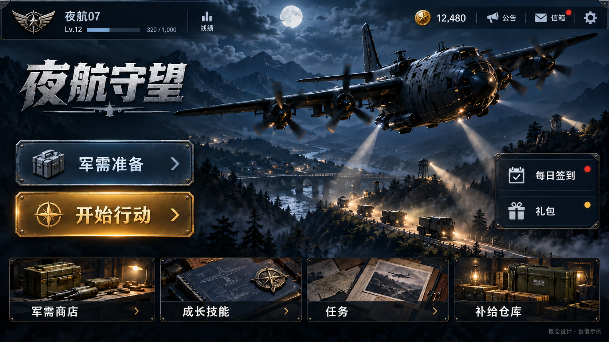
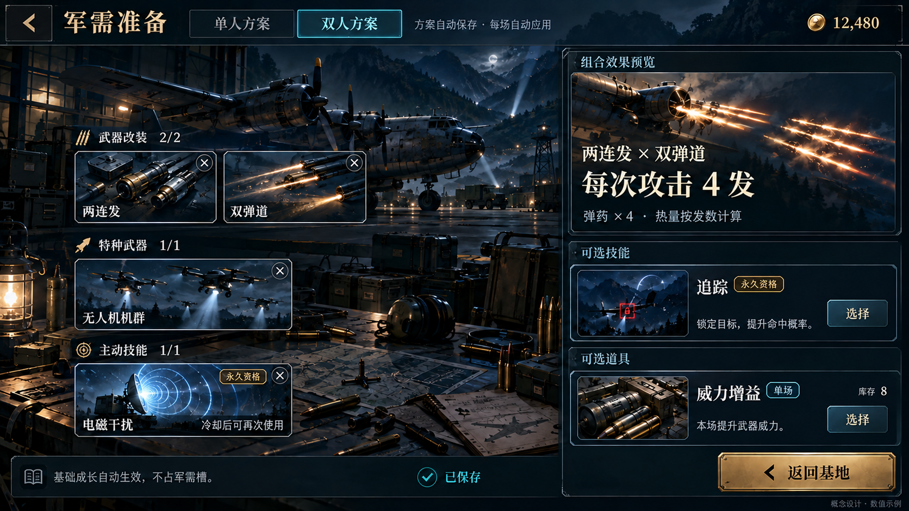
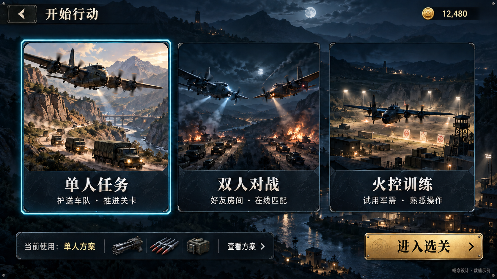
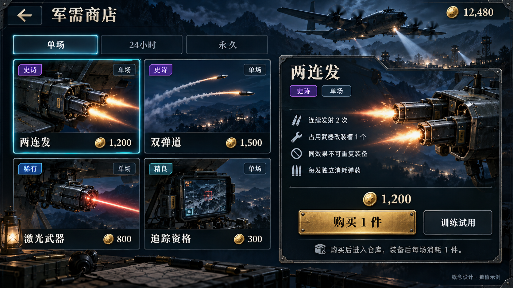
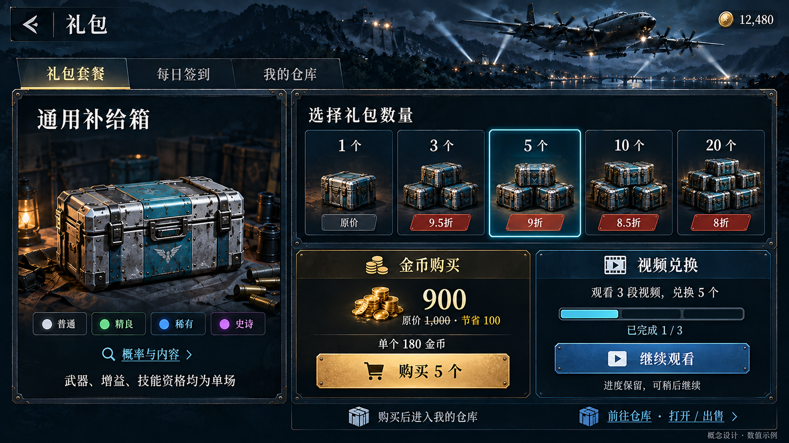
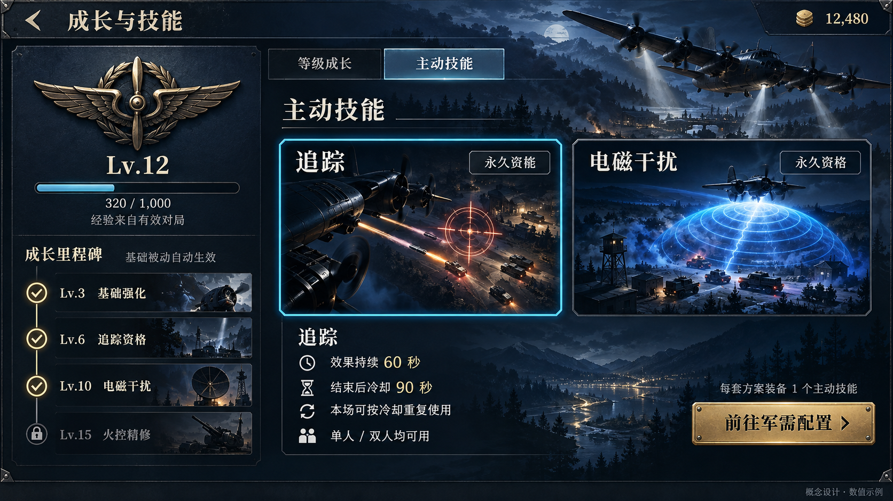
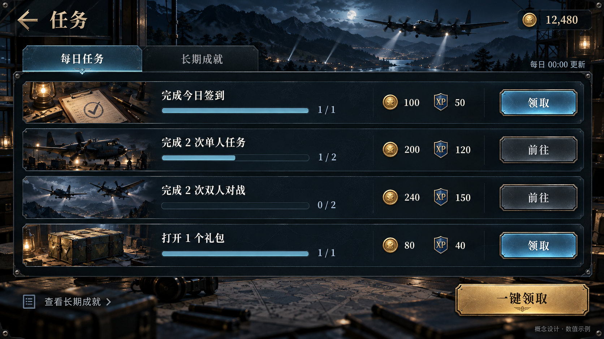
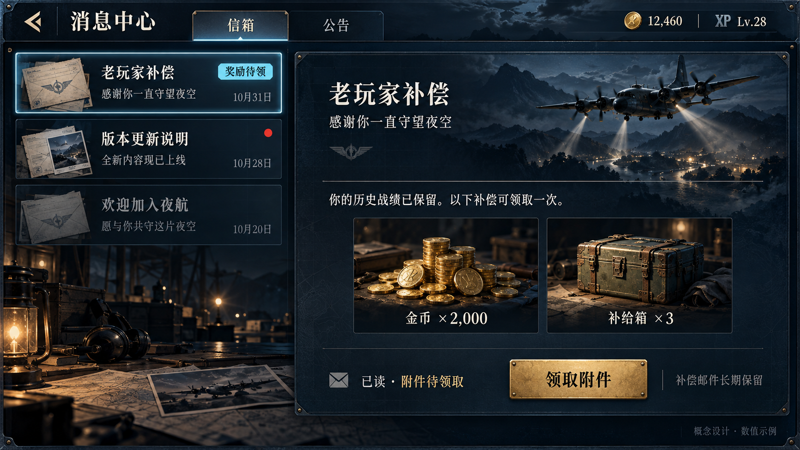
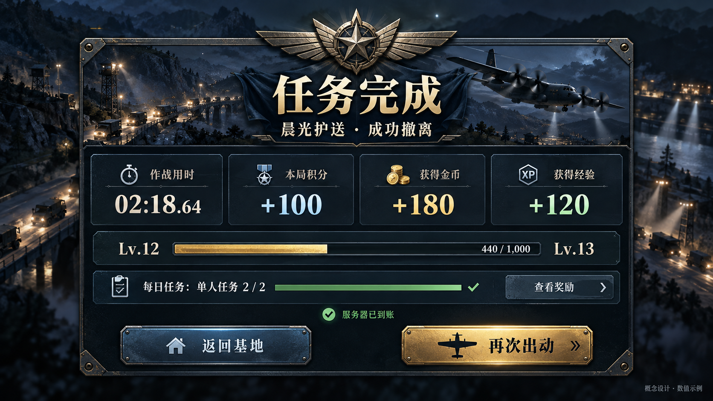

# 夜航守望 · 成长与军需关键效果图

启动：2026-10-31；修订：2026-11-01。**九张图仍为概念设计。用户本轮明确指定 `358b1fe0` 为实施基准，运行代码已实现；这些图本身仍不是游戏实机截图。**

[产品方案](../2026-10-29-personal-assets-plan.md) · [六批实施计划](../personal-assets-implementation-plan.md) · [当前界面规范](../interface.md)。

## 当前采用版本

本目录仅保存本轮选择的最终版本。首页与礼包已纳入2026-11-01用户反馈；被替换的初稿仍由生成工具保留在原生成目录，不作为本图册目标。后续实现先按本次反馈及认可页面确定基准，不恢复旧“广告礼包”入口、旧按钮顺序或技能次数设定。

全部图片为内置 **image_gen.imagegen** 生成，未使用CLI/API替代。原始提示词及精确修改提示词见[prompts.json](prompts.json)，其中initialPrompt只用于溯源，发生冲突时以finalEdit和当前产品方案为准。尺寸、字节与SHA-256见[manifest.json](manifest.json)。

所有图片实际为1672×941 PNG、接近16:9。提示词中的1920×1080是生成目标，不冒充实际分辨率；它们用于评审，不作为渠道宣传图或上线素材。图中的金币、经验、Lv、奖励、价格、折扣、概率及冷却为示例；文案/数值正式实现使用引擎动态绘制，不烘焙进背景。

| 页面 | 文件 | 当前重点 |
| --- | --- | --- |
| 首页 | [01-home.png](01-home.png) | 按最新反馈调整为军需准备在上、开始行动在下；右侧入口为每日签到与礼包。金色仍用于开始行动，底部四个体系入口保留。 |
| 军需准备 | [02-loadout.png](02-loadout.png) | 单人/双人方案独立，示例展示双人方案、2/1/1类目上限、两连发与双弹道组合预览，以及已永久拥有的个人技能。库存数量不等于技能施放次数。 |
| 开始行动 / 模式选择 | [03-mode-selection.png](03-mode-selection.png) | 单人、双人、训练由同一模式页面承载；只展示当前军需摘要，不要求经过配置。已移除金币旁无意义的加号；双人插画仅表达模式，不增加飞机互相攻击玩法。 |
| 军需商店 | [04-shop.png](04-shop.png) | 单场、24小时、永久分类；商品明码金币价，展示效果、槽位、同效果限制和训练试用。图中价格是示例。 |
| 礼包套餐 | [05-supply.png](05-supply.png) | 最新方案：1、3、5、10、20个套餐，金币购买/视频兑换两条路径，批量折扣。选中5个时展示900金币或3段视频的示例，视频进度保留；仓库可打开和出售。标签中的折扣只描述金币示例报价，视频需求另行显示。 |
| 成长与技能 | [06-growth-skills.png](06-growth-skills.png) | 基础成长自动生效，追踪和电磁干扰为个人技能；永久的是资格，技能按冷却反复发动。Lv门槛与冷却秒数为示例，不是上线数值。 |
| 每日任务 | [07-tasks.png](07-tasks.png) | 四项每日目标直接显示条件、进度和奖励，包含一键领取；没有活跃条、活跃币或累计活跃宝箱。正式每日由服务器产生3～5项。 |
| 信箱与补偿 | [08-inbox.png](08-inbox.png) | 公开公告与个人信箱分开；打开补偿邮件后状态为已读，但附件仍待领取。金币和礼包附件仅可领一次，图中补偿金额/账号数据为示例。 |
| 结算 | [09-settlement.png](09-settlement.png) | 原积分与新增金币、经验分别显示，并显示服务器到账状态及任务进度。背景是概念装饰，实际实现须保留真实战斗末帧，不据此重做战场或声称已有该画质。 |

## 01 · 首页

按最新反馈调整为军需准备在上、开始行动在下；右侧入口为每日签到与礼包。金色仍用于开始行动，底部四个体系入口保留。

## 02 · 军需准备

单人/双人方案独立，示例展示双人方案、2/1/1类目上限、两连发与双弹道组合预览，以及已永久拥有的个人技能。库存数量不等于技能施放次数。

## 03 · 开始行动 / 模式选择

单人、双人、训练由同一模式页面承载；只展示当前军需摘要，不要求经过配置。已移除金币旁无意义的加号；双人插画仅表达模式，不增加飞机互相攻击玩法。

## 04 · 军需商店

单场、24小时、永久分类；商品明码金币价，展示效果、槽位、同效果限制和训练试用。图中价格是示例。

## 05 · 礼包套餐

最新方案：1、3、5、10、20个套餐，金币购买/视频兑换两条路径，批量折扣。选中5个时展示900金币或3段视频的示例，视频进度保留；仓库可打开和出售。标签中的折扣只描述金币示例报价，视频需求另行显示。

## 06 · 成长与技能

基础成长自动生效，追踪和电磁干扰为个人技能；永久的是资格，技能按冷却反复发动。Lv门槛与冷却秒数为示例，不是上线数值。

## 07 · 每日任务

四项每日目标直接显示条件、进度和奖励，包含一键领取；没有活跃条、活跃币或累计活跃宝箱。正式每日由服务器产生3～5项。

## 08 · 信箱与补偿

公开公告与个人信箱分开；打开补偿邮件后状态为已读，但附件仍待领取。金币和礼包附件仅可领一次，图中补偿金额/账号数据为示例。

## 09 · 结算

原积分与新增金币、经验分别显示，并显示服务器到账状态及任务进度。背景是概念装饰，实际实现须保留真实战斗末帧，不据此重做战场或声称已有该画质。

## 本轮检查与后续边界

已逐张查看生成结果，并检查最新首页顺序、礼包名称和五档套餐、金币/视频两种获取方式、改装组合、个人技能无次数限制、无活跃条、未读与附件领取分离及结算资源分列。图片可读性、尺寸、哈希与文档相对链接另行检查。

本轮仍是视觉方向评审，不代表568×320手机实际点击、动态布局、Creator材质加载或真机通过。列表与商品详情在窄横屏需分步/滚动，不可把整张1672图硬缩小后宣称热区合格；实际需按同尺寸对照，保留44 CSS px等效触控目标。

实施前按相应批次补齐战斗技能HUD、24小时激活/续期、仓库出售与概率详情、视频订单失败恢复、金币不足、邮件已领、结算待同步等关键状态，不将九张主要页面图当成全状态验收。此处不注册为运行资产，也不替换publishing中的真实媒体。

## 运行资产与补充状态

本轮按九张图的背景、插画、主次布局和材质制作真实Cocos页面，动态数值以服务器为准。[精确图像生成请求](runtime-prompts.json)保留清背景、透明字标/徽章与皮肤的来源；对应尺寸和摘要登记在[资产清单](../../ASSET_MANIFEST.json)。

[补充状态图](10-secondary-states.png)用于仓库、确认、断线以及技能生效/冷却的构图参考，属于概念图，图中文字与数值不作为规则依据。正式EMP为4秒效果、45秒冷却；追踪为60秒效果、90秒冷却。图中额外标签不增加产品体系。实际状态由运行截图验证，不把此图用于上架素材。
