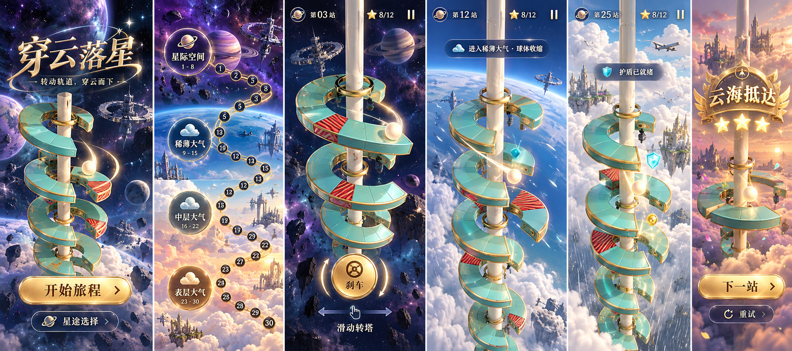

# 穿云落星 · Cocos 改造

先生成概念图，再实现游戏。名称《穿云落星》，副标题“转动轨道，穿云而下”。

## 环境节奏

根据用户补充，短关固定一种环境，景物可以稍大；无尽使用局部环境与缓慢的近远运动，不显示完整地球来代替空间。每段72层，末24层渐变；星际、稀薄、中层、表层、中层、稀薄循环，避免低空突跳太空。两组天空图集在同一环境内缓慢交替，下降时增加垂直视差，近景物体只在视野外更新。切换取决于下落距离，暂停不会推进。

天空图集是远背景；厚环、金边倒角、柱体、球、不同结构的空间站、航天器、飞机、鸟和近远云层是Cocos三维网格。前景云避开碰撞通道，天气粒子留在周围；危险斜纹与雷达承担可读性。球体实际半径参与缺口与危险区判定。

真实实现保留概念图的青玉、金边、暖色星光和逐层天空；精细装饰、电影级云体积与复杂飞船纹理没有照搬。这里采用适合移动浏览器的小型网格和层次运动，未调用Hyper3D。

## 对照与证据

当前实际截图位于[上架截图目录](../../../publishing/gameplay/screenshots/)，完整触屏录像与独立宣传剪辑见[资料清单](../../../publishing/STATUS.md)。[浏览器报告](browser-report.json)记录实际制品源码摘要、操作检查及引擎提示。图集与宣传插画的提示词见[prompts.md](prompts.md)，概念图不能代替实机截图。

[最终验证记录](verification.md)包含实际通过的检查、版本摘要、截图与概念差异，以及尚未进行的真机和渠道验证。
