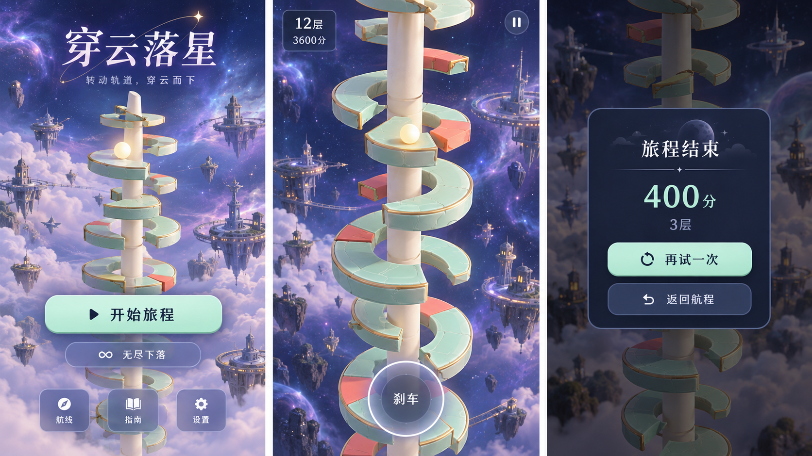

# 穿云落星 · 交互与动态环境修订

2026-10-23，先生成UI效果图，再修改代码。用户要求修复塔环侧面闪烁、空白按钮；移除背景景物名称；两种模式都有持续微动，闯关在同一环境循环，无尽轮换环境并自然过渡。

当轮改动实现了薄荷主按钮、深蓝次按钮、无粗描边文字及明确留白，未新增背景插画里的浮岛建筑；这是历史范围和差异记录，概念图不是真机证据。后续改版须完整落实最新认可图的配色、材质、插画与细节，不以当轮按钮和排版范围降低视觉标准。

## 生成来源

内置 image_gen，原文件 exec-d5cd55dd-694a-413b-8a5f-dbbca145f4d8.png。

以下保留当轮生成提示原文，仅用于追溯来源，其中的既有风格限制不适用于后续新要求。

提示词：

Create a fresh UI refinement concept board for the existing Chinese portrait 3D mobile game 穿云落星, exactly THREE tall 9:16 screens side by side on one landscape board: home, gameplay, failed-run result. This is UI design reference before implementation, not a promotional poster. Keep the existing actual toy-like mint ceramic broken ring platforms with thin matte gold trim, narrow ivory spindle, luminous warm-white ball, and coral danger wedges, in a purple-blue space atmosphere. Improve radically the interface: sophisticated minimal playful game design, calm legible typography, no black outlined glyphs, no double borders, no gold hairline ornaments, no embossed chunky gold buttons. Buttons use fresh pale mint fill, deep navy plain Chinese text, radius 12px, single subtle 4px shadow, optional tiny left icon. Secondary controls are translucent slate-blue panels with white clean text, not gold-bordered pills. Airy spacing, compact HUD, unobtrusive small icons. HOME: title 穿云落星 at top, subtitle 转动轨道，穿云而下, beautiful tower with lots of space, main mint button 开始旅程 and understated secondary 无尽下落, bottom three equal square-rounded tabs 航线 指南 设置. GAMEPLAY: small top-left clean HUD 12层 and 3600分, minimal pause icon top-right, tower prominent, small translucent bottom brake disc with clear word 刹车; no floating names or labels on decorative planets/space stations/birds, those only visible as subtle distant background objects; no debug text or percentage labels scattered around. RESULT: one compact centered opaque navy rounded panel over dimmed tower, heading 旅程结束, readable 400分 and 3层, first mint button 再试一次, second understated button 返回航程, exactly two fully labeled controls, no empty button, no repeated retry controls. The sky should suggest depth with soft distant nebula, tiny station and gently layered clouds in secondary background, no complete Earth, no giant white featureless sphere. Refined production-achievable Cocos geometry and UI, all Chinese text crisp. No device frame, no decorative arrow annotations, no extra labels, no web dashboard.

## 实际改动与验收

塔环仅在真实缺口封口，材质分界和整圆接缝不再生成重复侧面；金边与主体分离。按钮统一薄荷与深蓝样式，修正无尽结算重复ID导致的空白文字，检查所有控件的标签、中心位置及互不重叠。景物不再显示名称。

新增[第二组天空图集与提示词](sky-prompt.md)，两组天空在同一环境内缓慢交替并随下降移动。闯关固定环境；无尽每段72层、末24层渐变，按星际→稀薄→中层→表层→中层→稀薄循环。近远云层和物体有不同视差，离开视野后才更换景物。

实际触屏自动操作完成80层无尽及首次跨环境变化；其余方向通过隔离存档的开发夹具检查。20张实机截图及58.84秒录像见[资料清单](../../../publishing/STATUS.md)。50项规则/制品/网格测试包含重叠面、缺口封口及环境循环连续性。
